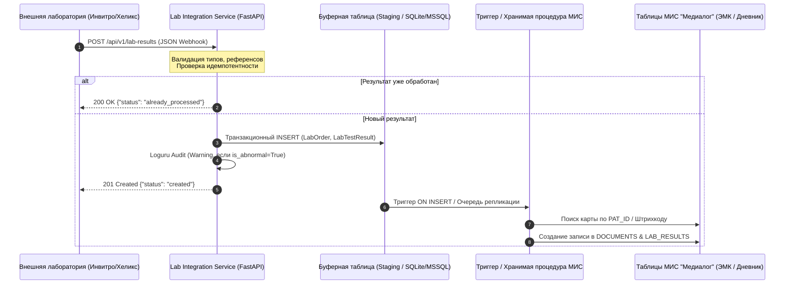

# Medical Laboratory Integration Microservice (МИС Клиники ВРТ / ЭКО)

Компактный высоконадежный микросервис автоматического приема, валидации, обеспечения строгой идемпотентности и транзакционного сохранения результатов лабораторных исследований от внешних лабораторий (Инвитро, Хеликс, ЦМД, KDL и др.).

Разработан как ключевой модуль интеграционного контура Медицинской Информационной Системы (МИС) клиники репродуктивной медицины и ЭКО.

---

## 1. Бизнес-контекст репродуктивной медицины (ВРТ / ЭКО)

В сфере вспомогательных репродуктивных технологий (ВРТ) лабораторная диагностика является основой принятия критических врачебных решений в режиме реального времени:

1. **Тайминг триггера овуляции (окно 2–4 часа):**
   Решение о назначении триггера финального созревания ооцитов (ХГЧ или агонист ГнРГ) и точном времени трансвагинальной пункции фолликулов принимается строго на основе динамики **Эстрадиола (E2)** и **ЛГ**. Задержка или потеря результата грозит преждевременной спонтанной овуляцией либо синдромом гиперстимуляции яичников (СГЯ).
2. **Окно имплантации в криопротоколах:**
   Уровень **Прогестерона (PROG)** перед переносом эмбриона определяет рецептивность эндометрия. Превышение пороговых значений требует отмены свежего переноса и перехода в сегментированный цикл («Freeze-all»).
3. **Мониторинг ранней беременности:**
   Динамика прироста **b-ХГЧ** каждые 48 часов необходима для своевременной диагностики неразвивающейся или эктопической (внематочной) беременности.
4. **Оценка овариального резерва:**
   Уровень **Антимюллерова гормона (АМГ)** и **ФСГ** определяет выбор протокола стимуляции суперовуляции и дозировки гонадотропинов.

**Ключевые требования к интеграции:**
- **Нулевая толерантность к потере данных:** Гарантированная доставка и транзакционность.
- **Идемпотентность:** Исключение дублирования анализов при повторных ретраях webhook-уведомлений от лабораторий.
- **Аудит критических отклонений:** Моментальная фиксация аномальных значений (`is_abnormal = True`) для экстренного оповещения врача-репродуктолога.

---

## 2. Архитектура и стек технологий

- **Язык:** Python 3.11+
- **Фреймворк:** FastAPI (асинхронная обработка, валидация через OpenAPI)
- **Валидация данных:** Pydantic v2 (строгая типизация, очистка строк, валидация дат)
- **СУБД и ORM:** SQLite + SQLAlchemy 2.0 (Modern Declarative Base, `Mapped`, `mapped_column`, Foreign Keys с каскадным удалением)
- **Логирование и аудит:** Loguru (структурированные логи с контекстом заказа, пациента и ротацией файлов)

### Схема базы данных
```text
┌──────────────────────┐         ┌──────────────────────┐         ┌──────────────────────┐
│       patients       │         │      lab_orders      │         │   lab_test_results   │
├──────────────────────┤         ├──────────────────────┤         ├──────────────────────┤
│ id (PK)              │1       *│ id (PK)              │1       *│ id (PK)              │
│ external_id (MED-xxx)│────────<│ patient_id (FK)      │────────<│ order_id (FK)        │
│ full_name            │         │ order_barcode (UQ)   │         │ test_code            │
│ birth_date           │         │ lab_name             │         │ test_name            │
│ gender               │         │ order_date           │         │ value, numeric_value │
│ created_at           │         │ status               │         │ unit, reference_range│
└──────────────────────┘         │ created_at           │         │ is_abnormal (bool)   │
                                 └──────────────────────┘         │ sample_date          │
                                                                  │ received_at          │
                                                                  └──────────────────────┘
                                                                  UQ(order_id, test_code)
```

**Гарантия идемпотентности:**
Уникальный составной ключ `UNIQUE(order_id, test_code)` на уровне схемы БД и превентивная проверка в сервисном слое предотвращают появление дубликатов при повторной отправке данных внешней лабораторией.

---

## 3. Сценарий интеграции с МИС "Медиалог"

МИС «Медиалог» (разработка компании Post Modern Technology) использует реляционную архитектуру (чаще всего MS SQL Server). Прямая запись внешних вебхуков в боевые таблицы (`PATIENTS`, `DOCUMENTS`, `USLUGI`, `FM_ACTION`) не рекомендуется из соображений безопасности и блокировок транзакций.

### Архитектурная схема интеграции



### Схема Staging-таблицы в МИС "Медиалог" (T-SQL)

Для взаимодействия с МИС развертывается промежуточная staging-таблица:

```sql
CREATE TABLE STG_LAB_RESULTS_INBOX (
    ID INT IDENTITY(1,1) PRIMARY KEY,
    ORDER_BARCODE VARCHAR(64) NOT NULL,
    MEDIALOG_PAT_ID INT NULL,                 -- Внутренний ID пациента в Медиалоге
    PATIENT_CARD_NUM VARCHAR(64) NOT NULL,    -- Номер карты (MED-100234)
    LAB_NAME VARCHAR(100) NOT NULL,
    TEST_CODE VARCHAR(64) NOT NULL,
    TEST_NAME NVARCHAR(255) NOT NULL,
    RESULT_VALUE NVARCHAR(128) NOT NULL,
    NUMERIC_VALUE FLOAT NULL,
    UNIT NVARCHAR(64) NOT NULL,
    REFERENCE_RANGE NVARCHAR(128) NOT NULL,
    IS_ABNORMAL BIT NOT NULL DEFAULT 0,
    SAMPLE_DATE DATETIME NOT NULL,
    RECEIVED_AT DATETIME DEFAULT GETDATE(),
    PROCESS_STATUS INT DEFAULT 0,             -- 0: New, 1: Processed, 2: Error
    ERROR_MESSAGE NVARCHAR(MAX) NULL
);

-- Индекс идемпотентности
CREATE UNIQUE NONCLUSTERED INDEX UQ_STG_ORDER_TEST 
ON STG_LAB_RESULTS_INBOX (ORDER_BARCODE, TEST_CODE);
```

### Хранимая процедура / Триггер переноса в ЭМК МИС "Медиалог"

```sql
CREATE OR ALTER PROCEDURE sp_ProcessLabResultToMedialog
    @StagingID INT
AS
BEGIN
    SET NOCOUNT ON;
    BEGIN TRANSACTION;
    TRY
        DECLARE @PatId INT, @DocId INT;
        DECLARE @CardNum VARCHAR(64), @TestName NVARCHAR(255), @Val NVARCHAR(128);

        SELECT @CardNum = PATIENT_CARD_NUM, @TestName = TEST_NAME, @Val = RESULT_VALUE
        FROM STG_LAB_RESULTS_INBOX WHERE ID = @StagingID;

        -- 1. Поиск внутреннего пациента Медиалога
        SELECT @PatId = PAT_ID FROM PATIENTS WHERE CARD_NUM = @CardNum;
        IF @PatId IS NULL
        BEGIN
            UPDATE STG_LAB_RESULTS_INBOX 
            SET PROCESS_STATUS = 2, ERROR_MESSAGE = 'Пациент с указанной картой не найден'
            WHERE ID = @StagingID;
            COMMIT TRANSACTION;
            RETURN;
        END

        -- 2. Вставка в лабораторный журнал МИС (DOCUMENTS / LAB_DATA)
        INSERT INTO DOCUMENTS (PAT_ID, DOC_TYPE, CREATE_DATE, DESCR)
        VALUES (@PatId, 'LAB_PROTOCOL', GETDATE(), 'Результат исследования: ' + @TestName);
        SET @DocId = SCOPE_IDENTITY();

        -- 3. Обновление статуса в стейджинге
        UPDATE STG_LAB_RESULTS_INBOX 
        SET PROCESS_STATUS = 1, MEDIALOG_PAT_ID = @PatId 
        WHERE ID = @StagingID;

        COMMIT TRANSACTION;
    CATCH
        ROLLBACK TRANSACTION;
        UPDATE STG_LAB_RESULTS_INBOX 
        SET PROCESS_STATUS = 2, ERROR_MESSAGE = ERROR_MESSAGE() 
        WHERE ID = @StagingID;
    END CATCH
END;
```

---

## 4. Инструкция по установке и запуску

### Шаг 1. Клонирование и создание виртуального окружения
```bash
git clone <repo_url> lab_integration_service
cd lab_integration_service

python3 -m venv venv
source venv/bin/activate  # Для Windows: venv\Scripts\activate
```

### Шаг 2. Установка зависимостей
```bash
pip install -r requirements.txt
```

### Шаг 3. Заполнение базы тестовыми данными (Seed Data)
Скрипт создает 5 пациентов репродуктивной клиники и историю анализов:
```bash
python seed_data.py
```

### Шаг 4. Запуск микросервиса
```bash
uvicorn app.main:app --reload --host 0.0.0.0 --port 8000
```
- **Интерактивный веб-интерфейс (Web UI с пресетами и ЭМК):** `http://localhost:8000/`
- **Документация Swagger UI:** `http://localhost:8000/docs`

---

## 5. Примеры curl-запросов

### 1. Отправка нового анализа (АМГ для пациентки Ивановой А.С.)
```bash
curl -X POST "http://localhost:8000/api/v1/lab-results" \
     -H "Content-Type: application/json" \
     -d '{
       "order_id": "INV-2026-992384",
       "patient_id": "MED-100234",
       "lab_name": "Invitro",
       "test_code": "AMH",
       "test_name": "Антимюллеров гормон (АМГ)",
       "value": "4.85",
       "unit": "нг/мл",
       "reference_range": "1.20 - 4.50",
       "is_abnormal": true,
       "sample_date": "2026-10-23T08:30:00"
     }'
```
**Ответ (201 Created):**
```json
{
  "status": "created",
  "message": "Результат исследования успешно принят и сохранен",
  "order_id": "INV-2026-992384",
  "test_code": "AMH",
  "result_id": 5,
  "is_abnormal": true
}
```

### 2. Повторная отправка того же анализа (Проверка идемпотентности)
```bash
curl -X POST "http://localhost:8000/api/v1/lab-results" \
     -H "Content-Type: application/json" \
     -d '{
       "order_id": "INV-2026-992384",
       "patient_id": "MED-100234",
       "lab_name": "Invitro",
       "test_code": "AMH",
       "test_name": "Антимюллеров гормон (АМГ)",
       "value": "4.85",
       "unit": "нг/мл",
       "reference_range": "1.20 - 4.50",
       "is_abnormal": true,
       "sample_date": "2026-10-23T08:30:00"
     }'
```
**Ответ (200 OK - Идемпотентно, дубликат не создан):**
```json
{
  "status": "already_processed",
  "message": "Результат данного исследования уже был сохранен ранее",
  "order_id": "INV-2026-992384",
  "test_code": "AMH",
  "result_id": 5,
  "is_abnormal": true
}
```

### 3. Добавление второго показателя в тот же заказ (Эстрадиол E2)
```bash
curl -X POST "http://localhost:8000/api/v1/lab-results" \
     -H "Content-Type: application/json" \
     -d '{
       "order_id": "INV-2026-992384",
       "patient_id": "MED-100234",
       "lab_name": "Invitro",
       "test_code": "E2",
       "test_name": "Эстрадиол (E2)",
       "value": "1250.0",
       "unit": "пмоль/л",
       "reference_range": "77.0 - 921.0",
       "is_abnormal": true,
       "sample_date": "2026-10-23T08:30:00"
     }'
```

### 4. Выгрузка хронологической истории анализов пациентки
Запрос по номеру карты в МИС (`MED-100234`) или внутреннему ID (`1`):
```bash
curl -X GET "http://localhost:8000/api/v1/patients/MED-100234/lab-history"
```
**Ответ (200 OK):**
```json
{
  "patient_id": 1,
  "external_id": "MED-100234",
  "full_name": "Иванова Анна Сергеевна",
  "total_results": 4,
  "abnormal_count": 3,
  "history": [
    {
      "result_id": 5,
      "order_id": "INV-2026-992384",
      "lab_name": "Invitro",
      "test_code": "AMH",
      "test_name": "Антимюллеров гормон (АМГ)",
      "value": "4.85",
      "numeric_value": 4.85,
      "unit": "нг/мл",
      "reference_range": "1.20 - 4.50",
      "is_abnormal": true,
      "sample_date": "2026-10-23T08:30:00",
      "received_at": "2026-10-23T12:00:00"
    },
    {
      "result_id": 6,
      "order_id": "INV-2026-992384",
      "lab_name": "Invitro",
      "test_code": "E2",
      "test_name": "Эстрадиол (E2)",
      "value": "1250.0",
      "numeric_value": 1250.0,
      "unit": "пмоль/л",
      "reference_range": "77.0 - 921.0",
      "is_abnormal": true,
      "sample_date": "2026-10-23T08:30:00",
      "received_at": "2026-10-23T12:00:00"
    }
  ]
}
```

---

## 6. Структурированный аудит и логирование (Loguru)

Микросервис ведет структурированный аудит в двух потоках:
1. **Stdout:** Цветовая индикация ключевых событий жизненного цикла запросов.
2. **Файловый лог `logs/lab_audit.log`:** С ротацией при достижении 10 МБ и хранением архивов до 30 дней.

Пример лога при обнаружении критического отклонения:
```text
2026-10-23 12:05:14.210 | WARNING  | app.service:process_lab_result | [AUDIT-ALERT] ВНИМАНИЕ! Зафиксировано критическое/аномальное значение! Пациент: Иванова Анна Сергеевна (карта: MED-100234), Тест: AMH (Антимюллеров гормон (АМГ)), Результат: 4.85 нг/мл, Норма: '1.20 - 4.50' | context={'order_barcode': 'INV-2026-992384', 'test_code': 'AMH', 'lab_name': 'Invitro', 'patient_ref': 'MED-100234'}
```
